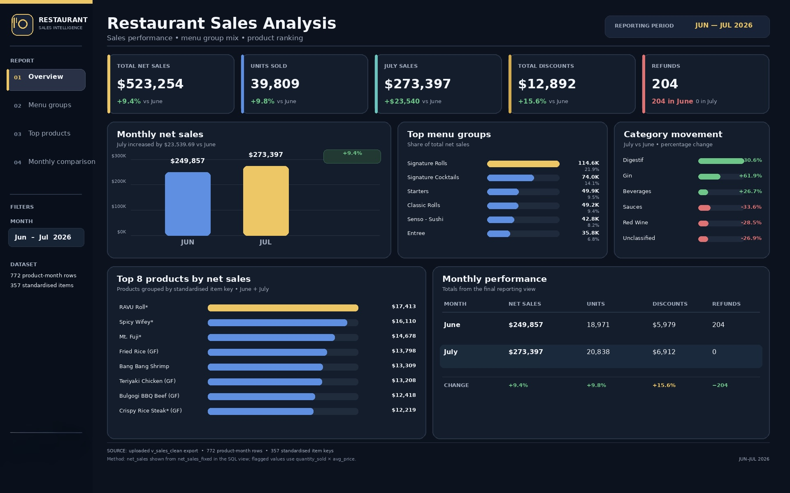

# Restaurant Sales Analysis | SQL & Power BI

## Project Overview



## Key Findings

- **Revenue grew 9.4% month over month**, from $249.9K in June to $273.4K in July. Units sold grew 9.8% (18,971 to 20,838).
- **Signature Rolls are the largest category** (about 22% of total revenue), followed by Signature Cocktails (about 14%).
- **Growth came mostly from items sold in both months.** The biggest gains were RAVU Roll (+$1,973), Teriyaki Chicken (+$1,682) and Crispy Rice Flight (+$1,161). Items sold in only one month were small (under €1,000 each).
- **Spicy Wifey declined by $1,050 (-12%)**, mainly because fewer units were sold (414 to 367), not because of price (average $20.72 vs. $20.52).
- **Items with the z:checkmate- prefix make up about 7% of revenue** and declined 8% from June to July. The meaning of the prefix is not documented in the source data.

## Data Quality Issues Found

| Issue | What I found | How I handled it |
|---|---|---|
| Truncated revenue | 132 item rows with quantity x price above €1,000 had net_sales cut off (e.g. RAVU Roll in July showed 9 instead of about 9,259), apparently at the thousands separator | Recalculated as quantity_sold x avg_price in net_sales_fixed (approximate, because avg_price is rounded) |
| Summary rows mixed with data | 16 subtotal and Grand Total rows | Removed. Item quantities then matched the Grand Total exactly (18,971 in June, 20,838 in July) |
| Duplicate rows | 3 beer rows in June repeated "Bottle Beer" (168 units) | Removed |
| Inconsistent names | z:checkmate- prefix, dietary tags such as (GF), inconsistent group labels | Created item_clean, item_key and is_checkmate, fixed menu_group labels |
| Wine entries | Wine appears to be recorded differently across months (parent rows with zero sales) | Excluded from item-level comparisons |

This project explores restaurant sales data for **June and July** using **MySQL** and **Power BI**. The goal is to prepare the source data for analysis, check data quality, standardise product information, and identify sales patterns across menu categories and individual products.

The SQL workflow covers data exploration, data cleaning, validation, product-name standardisation, month-over-month comparisons, and the creation of a reporting view for Power BI.

## Tools & Technologies

- **MySQL** – data exploration, cleaning, transformation, and analysis
- **SQL** – filtering, aggregations, `CASE`, CTEs, window functions, subqueries, and views
- **Power BI** – interactive reporting and dashboard visualisation

## Project Workflow

### 1. Data Exploration

The initial exploration examines:

- Total row counts and the number of records by month
- Table structure and column data types
- Record counts by menu group
- Rows with missing product names and summary records
- Top-selling products in June and July

### 2. Data Quality Checks

The cleaning workflow includes checks for:

- Missing product names and other missing values
- Duplicate IDs
- Negative quantities, refunds, sales, prices, or discounts
- Records with a positive quantity but a zero average price
- Differences between product-level totals and reported summary values

### 3. Data Preparation & Standardisation

A working table named `restaurant_sales_clean` is created from the source table `restaurant_project_mysql`.

Additional transformations include:

- Creating `net_sales_fixed` as a derived sales field using a conditional comparison between reported net sales and `quantity_sold × avg_price`
- Creating `item_clean` to standardise product names
- Creating `is_checkmate` to identify product records with the `z:checkmate-` prefix
- Creating `item_key` to group equivalent product names for comparison
- Standardising selected menu-group labels

The derived `net_sales_fixed` field is a project-specific calculation used in subsequent analysis. It should be validated against the original source or transaction-level records before being treated as a definitive correction of reported sales.

### 4. Sales Analysis

The analysis focuses on sales performance across the two available months.

Examples of analytical questions include:

- How do total sales and quantities differ between June and July?
- Which menu categories generate the highest net sales?
- Which categories show the largest month-over-month changes?
- Which products generate the highest sales?
- Which products appear in only one of the two months?
- Which standardised products show the largest increases or decreases?
- How do records flagged with the `z:checkmate-` prefix contribute to sales?

The SQL uses aggregations, conditional calculations, CTEs, subqueries, and window functions to answer these questions.

### 5. Reporting View

The final step creates a SQL view named `v_sales_clean`, which exposes the prepared fields for reporting.

The view includes:

- Record ID
- Month label and month number
- Menu group
- Standardised item name and item key
- Checkmate flag
- Quantity sold
- Refunds
- Average price
- Discount
- Prepared net sales field

This view provides a consistent reporting layer that can be connected to Power BI.

## Repository Structure

```text
Restaurant-Sales-Analysis/
│
├── README.md
├── restaurant_sales_analysis.sql
└── dashboard/
    └── [Power BI dashboard files or screenshots]
```

*The file and folder names above are a suggested repository structure. Adjust them to match the actual files in the repository.*

## How to Use

1. Import the source dataset into MySQL.
2. Make sure the source table is named `restaurant_project_mysql` and contains the columns referenced in the SQL script.
3. Review the SQL script and run the setup and transformation statements in the intended order.
4. Run the analytical queries to inspect sales performance.
5. Create or refresh the `v_sales_clean` view.
6. Connect Power BI to the view and build the report.

### Execution Note

The SQL file contains exploratory queries and schema-changing statements developed during an iterative analysis. It is **not currently designed to be executed repeatedly as one uninterrupted script**. For a clean rerun, use a fresh copy of the source data and review one-time operations such as `CREATE TABLE`, `ALTER TABLE`, `UPDATE`, and `DELETE` before executing them. Some analysis queries depend on columns created later in the workflow, so run the relevant preparation steps first.

## Key SQL Skills Demonstrated

- Data exploration and profiling
- Data quality checks
- Data cleaning and standardisation
- `GROUP BY` and aggregate functions
- Conditional logic with `CASE`
- Common Table Expressions (CTEs)
- Subqueries
- Window functions
- Month-over-month comparisons
- Creating SQL views for BI reporting

## Notes & Limitations

- The dataset covers two months only: June and July.
- The available data is product/menu-level sales data; it does not provide customer IDs or transaction-level purchase histories. Therefore, customer retention or individual customer behaviour cannot be analysed from this dataset.
- Any derived or adjusted sales values should be checked against the original source before being used for financial reporting.
- The project is intended as a portfolio demonstration of SQL-based data preparation and sales analysis.

---

**Author:** Stanislav Radič  
**Focus:** Junior Data Analytics | SQL | MySQL | Power BI
